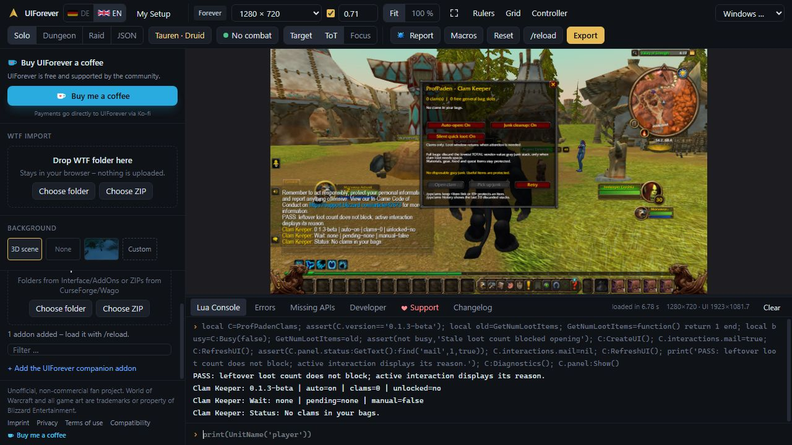
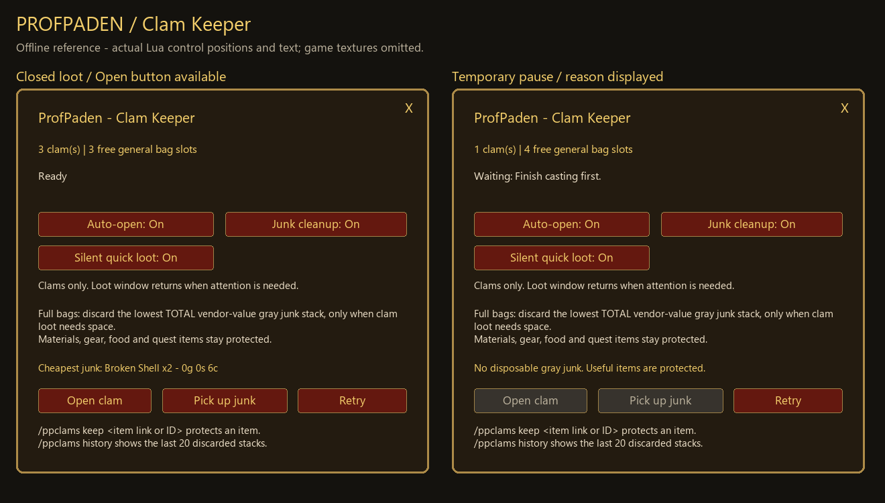

# Clam Keeper 0.1.3-beta validation

The repair addresses three reproducible failures: leftover loot-slot data disabling opening without an active loot session; an early busy return preventing pending-use timeouts; and manual PreClick disabling its own button before native dispatch. Temporary busy and locked-item states now resume automatically, and the panel reports why it is waiting. `/ppclams status` reports version, clam count, unlocked state, pending age and the last error received during an opening attempt.

Clam name detection is limited to loot containers, with the known clam IDs retained for other locales and incomplete cache data. Inventory protection, loot-source verification and silent quick-loot policies remain unchanged. No combat/item-use restrictions are bypassed. An error received during opening is diagnostic and does not establish its cause or grant ownership of unrelated loot.

## Verification

- 66 of 66 mocked Lua 5.1 checks passed. Eight new cases failed against the prior installed build and passed after repair. The suite covers stale loot counts, busy timeouts, lost wakeups, manual click dispatch, active foreign loot, locked clams, diagnostic output, named-container detection, stack draining, blocked APIs, full bags and valuable-item protection. Results: [clams-test-results.json](clams-test-results.json).
- UIForever build 1.60.1.70450, interface 16001: Tauren Druid Solo, 1280x720, UI scale 0.71, ProfPaden 0.20.33-rc1 and Clam Keeper 0.1.3-beta. Verified the loaded version, stale-count guard, interaction wait message, diagnostics and panel layout. No Lua errors. The simulator fixture had no clams; native secure item opening was not tested there.
- Runtime files byte-matched the locally installed, tested build. Release packaging checks verify all manifest hashes, TOC entries, addon folder structure and archive integrity.
- Source target: Forever interface 16001, upstream `Gethe/wow-ui-source` commit `eac30af597e5aaa43a60f6675ef5fdcea100375f` (1.60.1.70790), resolved November 6, 2026. Existing container APIs and secure item dispatch are retained.

Live item opening remains unconfirmed. After `/reload`, leave combat and close loot/trading windows. If it still stalls, collect `/ppclams status` to identify the blocker.

